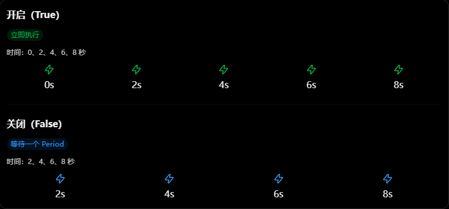
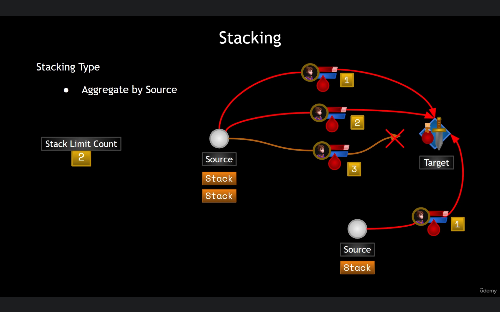
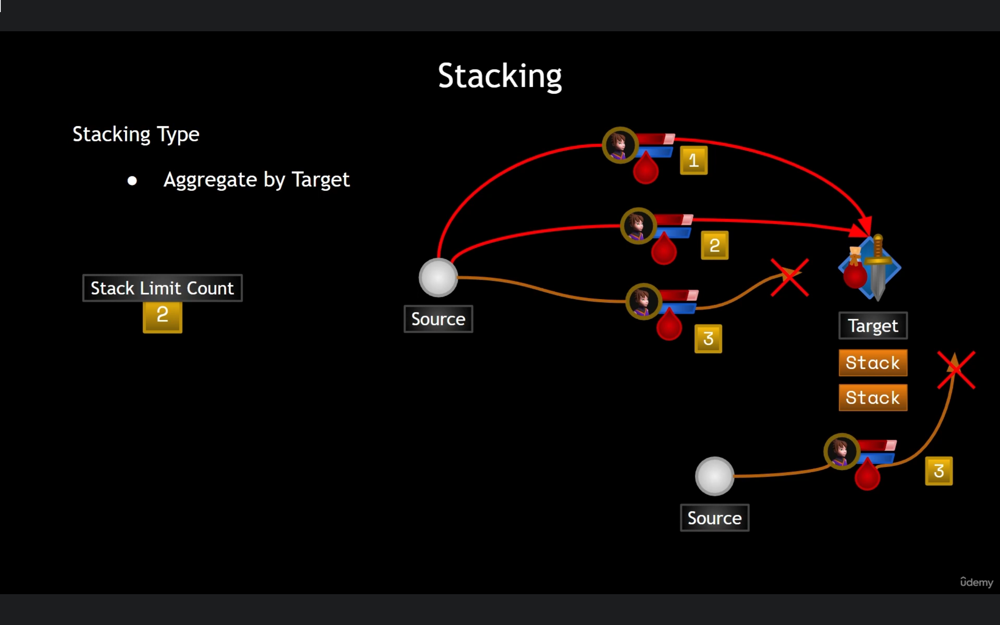
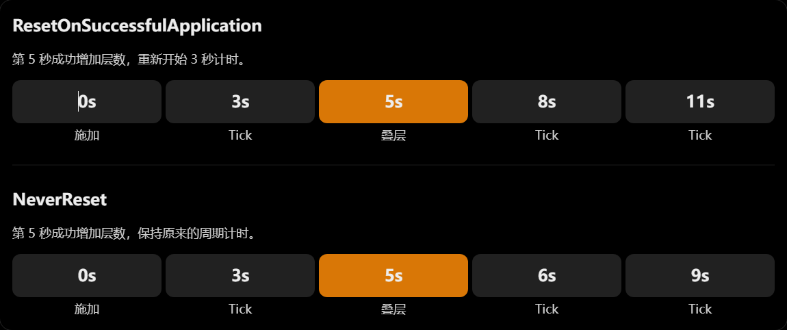
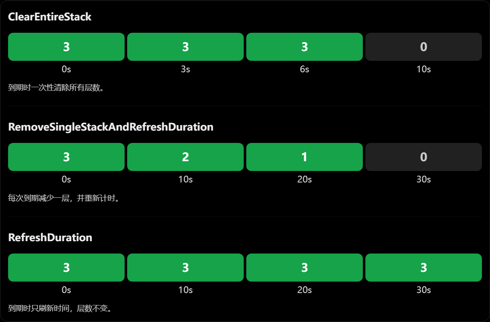

**Duration**

```c++
Duration Policy
// Instant : 瞬间效果
//	GE 应用时立即执行，无法进入 ASC 的 ActiveGameplayEffectsContainer
//	直接修改 Attribute 的 BaseValue

// Infinite : 永久持续
// GE 应用后，会进入 ASC 的 ActiveGameplayEffectsContainer
//	持续期间 Modifier 会影响 Attribute 的 CurrentValue

// HasDuration : 持续时间
//	GE 应用后，会进入 ASC 的 ActiveGameplayEffectsContainer，在指定时间内持续生效
//	持续期间 Modifier 会影响 Attribute 的 CurrentValue
```

```C++
Duration Magnitude
// 决定 GE 持续多长时间
```

```C++
Period
// 决定 GameplayEffect 每隔多少秒执行一次周期性效果
// 启用 Period 后，周期性执行的 Modifier 通常修改的是 Attribute 的 BaseValue，而不是像普通持续性 Modifier 那样持续叠加到 CurrentValue 上

```

```c++
Execute Periodic Effect On Application
// GE 刚刚应用时，是否立即执行一次周期效果
```



```C++
Periodic Inhibition Policy
// 当一个正在运行的 PeriodicGameplayEffect 被 Inhibit（抑制）后，已经安排的周期执行应该如何处理

	// NeverReset : 保持原来的周期时间
		// Period = 2 秒
		// 0 秒：GE 开始
		// 2 秒：第一次执行
		// 3 秒：GE 被 Inhibit
		// 4 秒：原定执行时间
		// 5 秒：GE 解除 Inhibit
		// 6 秒：下一次执行
		// 解除抑制后，按照原来的周期节奏继续执行

	// ResetPeriod : 重新开始计时
		// Period = 2 秒
		// 0 秒：GE 开始
		// 2 秒：第一次执行
		// 3 秒：GE 被 Inhibit
		// 5 秒：GE 解除 Inhibit
		// 7 秒：下一次执行
		// 9 秒：再次执行
		// 解除抑制后，必须重新等待完整的 2 秒

	// ExecuteAndResetPeriod : 解除抑制时立即执行
		// Period = 2 秒
		// 0 秒：GE 开始
		// 2 秒：第一次执行
		// 3 秒：GE 被 Inhibit
		// 5 秒：GE 解除 Inhibit，立即执行
		// 7 秒：再次执行
		// 9 秒：再次执行
		// 解除抑制后立即执行一次周期效果，重置 Period 计时器，等待完整的 Period 后再执行下一次
```


**Stacking**

```c++
Stacking Type
	// No Stacking : 不进行堆叠，每次施加都是独立效果
		// 玩家A给敌人施加一次中毒
		// 玩家A再次给敌人施加一次中毒
		// 两次中毒是两个独立 GameplayEffect, 各自计算持续时间

	// Stack Per Source : 按施加来源进行堆叠
		// 玩家A给敌人施加一次中毒，形成一个堆叠
		// 玩家A再次给敌人施加一次中毒，增加同一个堆叠的层数
		// 玩家B给敌人施加一次中毒，形成另一个独立堆叠
		// 同一个 Source 的效果合并，不同 Source 的效果分开

	// Stack Per Target : 按目标进行堆叠，不区分施加来源
		// 玩家A给敌人施加一次中毒，层数为1
		// 玩家A给敌人施加一次中毒，层数为2
		// 玩家B给敌人施加一次中毒，层数为3
		// 玩家C给敌人施加一次中毒，层数为4
		// 只要目标相同，相同 GE 就会合并堆叠，不区分来源
```

```c++
Stack Limit Count
// 限制同一个 GameplayEffect 在目标身上最多能够堆叠多少层
```





```C++
StackDurationRefreshPolicy
// 当一个已经存在的 GameplayEffect 成功增加堆叠层数时，原有 GE 的持续时间应该如何变化

	// RefreshOnSuccessfulApplication : 刷新持续时间
		// 0 秒  第一次施加   1	10 秒
		// 6 秒  第二次施加   2	10 秒
		// 9 秒  第三次施加   3	10 秒
		// 15秒  无进行操作   3	 4 秒
	
	// NeverRefresh ：保持原始计时
		// 0 秒	第一次施加	1	10 秒
		// 6 秒	第二次施加	2	4  秒
		// 8 秒	第三次施加	3	2  秒
		// 10秒	无持续时间	0   结束
		
	// ExtendDuration : 累加剩余时间
		// 0 秒	第一次施加	1	10 秒
		// 6 秒	第二次施加	2	14 秒
		// 8 秒	第三次施加	3	22 秒
		// 10秒	无施加操作	4	30 秒
```

```C++
StackPeriodResetPolicy
// 当一个已经存在的周期性 GameplayEffect 增加新的堆叠层数时，下一次周期执行的计时是否重新开始

	// ResetOnSuccessfulApplication : 重新计算下一次 Tick 时间
		// 当新的 GE 成功增加堆叠层数时，当前周期计时进度会被丢弃，从零开始重新计时
		
	// NeverReset : 保持原有周期计时
		// 当新的 GE 成功增加堆叠层数时，不会重置当前周期计时进度

// 假设 Period = 3 秒，在第 5 秒增加一层：
```



```C++
StackExpirationPolicy
// 当一个具有持续时间的、可堆叠的 GameplayEffect 到期时，应该如何处理当前的堆叠层数

	// ClearEntireStack : 清除整个堆叠
		// 当 GameplayEffect 持续时间结束时，直接移除整个 ActiveGameplayEffect，所有堆叠层数一起消失
	
	// RemoveSingleStackAndRefreshDuration : 移除一层并刷新持续时间
	
	// RefreshDuration : 仅刷新持续时间
		// 配合 OnStackCountChange 回调，手动管理堆叠层数
```



```C++
FactorInStackCount
// 计算 GameplayEffect 的 Modifier Magnitude（修饰器数值）时，是否将当前堆叠层数纳入计算
	// false : 不考虑堆叠层数
		// StackingType = AggregateByTarget
		// StackLimitCount = 5
		// ModifierMagnitude = 10
			// StackCount	ModifierMagnitude
			//		1				10
			//		2				10
			//		3				10
			//		4				10
			//		5				10
			
	// true : 考虑堆叠层数
		// ModifierMagnitude = 10
		// Stack LimitCount = 5
		// FactorInStackCount = True
			// StackCount	BaseMagnitude	最终Magnitude
			//		1			10				10
			//		2			10				20
			//		3			10				30
			// 		4			10				40
			// 		5			10				50
```


```c++
OverflowEffects
// 可以配置额外的 GameplayEffect，在堆叠溢出时触发
```

```c++
DenyOverflowApplication
// 决定超过最大堆叠层数时，是否拒绝新的 GE 应用
	// False：允许新的应用请求进入堆叠处理，但 Stack Count 不超过上限
	// True：拒绝超过上限时的新应用，不刷新持续时间，也不更新 Context	
```

```c++
ClearStackOnOverflow
// 决定发生 Overflow 时，是否清空整个堆叠
	// False：保留原有 5 层
	// True：清空整个堆叠
```

